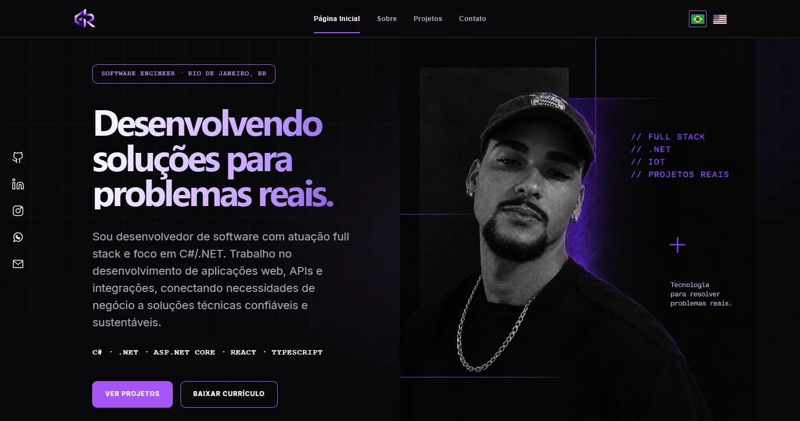

# 🚀 Guilherme Ribeiro — Portfólio Profissional

<p align="center">
  <a href="https://guilherme-ribeiro-dev.vercel.app/">
    
  </a>
</p>

<p align="center">
  <a href="https://guilherme-ribeiro-dev.vercel.app/"></a>
  
  
</p>

---

## 📖 Sobre o projeto

Este é meu portfólio profissional. Sou desenvolvedor full stack com foco em C# e .NET, e reuni aqui minha trajetória, meu currículo e projetos que mostram como trabalho com aplicações web, APIs, integrações e automação.

- [✨ Funcionalidades](#-funcionalidades)
- [💼 Projetos](#-projetos)
- [🛠️ Tecnologias](#️-tecnologias)
- [📂 Organização do código](#-organização-do-código)
- [🚀 Como executar](#-como-executar)
- [👨‍💻 Autor](#-autor)

---

## ✨ Funcionalidades

| Recurso | Descrição |
| --- | --- |
| 🌍 Navegação bilíngue | Troca entre português e inglês com preferência salva no navegador. |
| 📱 Layout responsivo | Menu para telas pequenas e organização do conteúdo conforme a largura da tela. |
| 📄 Currículo | Download em PDF direto pela página inicial. |
| ⚡ Carregamento | Imagens em WebP, carregamento sob demanda e prioridade para as imagens principais. |
| ♿ Navegação por teclado | Atalho para o conteúdo, foco visível e suporte à preferência por movimento reduzido. |

---

## 💼 Projetos

| Projeto | Descrição |
| --- | --- |
| [FindAll](https://guilherme-ribeiro-dev.vercel.app/projetos/findall.html) | Estudo de caso sobre monitoramento e rastreabilidade de ativos com IoT. |
| [Workstation Kit](https://guilherme-ribeiro-dev.vercel.app/projetos/workstation.html) | Estudo de caso sobre automação da configuração de ambientes Windows com PowerShell. |
| [FlowFin](https://guilherme-ribeiro-dev.vercel.app/#projetos) | Aplicativo full stack de finanças pessoais com .NET, React e TypeScript. O estudo de caso está em desenvolvimento. |

---

## 🛠️ Tecnologias

| Tecnologia | Uso no portfólio |
| --- | --- |
| **HTML5** | Estrutura das páginas e metadados de busca e compartilhamento. |
| **CSS3** | Layout com Grid e Flexbox, estilos responsivos e animações. |
| **JavaScript** | Troca de idioma, menu móvel e painéis interativos. |
| **Vercel** | Hospedagem do site estático. |

---

## 📂 Organização do código

```text
.
├── index.html          # Apresentação, projetos, contato e currículo
├── sobre.html          # Trajetória, formação e competências
├── projetos/           # Estudos de caso do FindAll e Workstation Kit
├── css/style.css       # Estilos, responsividade e animações
├── js/script.js        # Navegação, interações e traduções PT/EN
└── assets/
    ├── files/          # Currículo em PDF
    └── images/         # Imagens do site, do README e de compartilhamento
```

---

## 🚀 Como executar

Abra `index.html` no navegador. Para servir o site por HTTP, execute na raiz do repositório com Python 3 instalado:

```bash
python -m http.server 8000
```

Acesse [localhost:8000](http://localhost:8000/).

Para editar um texto, atualize o HTML e a entrada correspondente em `translations`, no arquivo `js/script.js`. A Vercel serve os arquivos estáticos a partir da raiz do projeto, sem etapa de compilação.

---

## 👨‍💻 Autor

**Guilherme Ribeiro**

[](https://www.linkedin.com/in/guiribcosta/)
